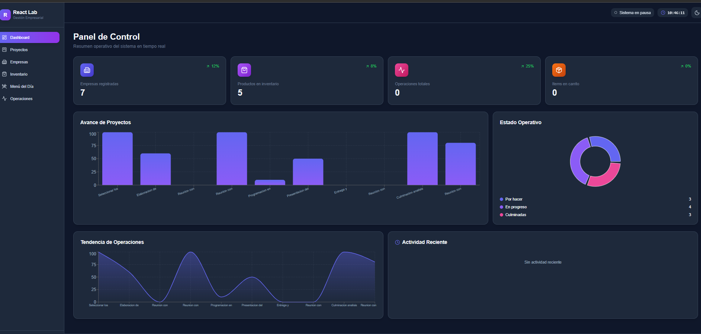
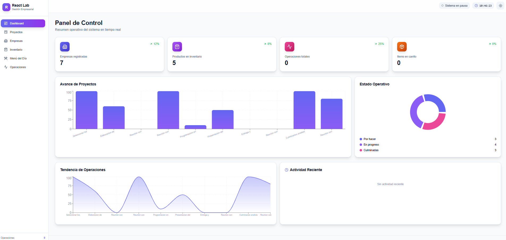
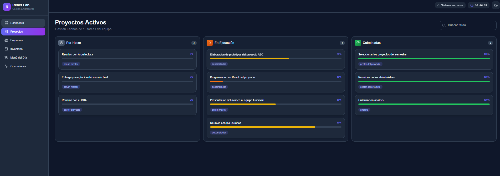
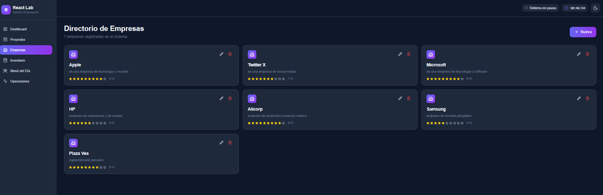
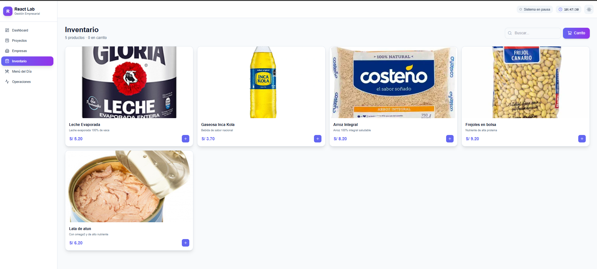

cat > README.md << 'EOF'

# ⚛️ React Lab · Sistema de Gestión Empresarial

Sistema web moderno construido con **React 18**, **Redux Toolkit**, **TailwindCSS** y **Framer Motion**. Simula un sistema empresarial completo con módulos de proyectos, empresas, inventario, menú y registro de operaciones en tiempo real.


---

## 🎯 ¿Qué es este proyecto?

Sistema de gestión empresarial que demuestra dominio de React moderno:

- ⚡ Arquitectura con hooks y Redux Toolkit
- 🎨 UI premium con TailwindCSS y modo oscuro
- 🎬 Animaciones fluidas con Framer Motion
- 📊 Gráficos interactivos con Recharts
- 🌐 Consumo de API REST con Axios
- 🔄 Estado global con Redux Toolkit
- 📱 Diseño 100% responsive

---

## 📸 Capturas

### 🌙 Dashboard (Modo Oscuro)



### ☀️ Dashboard (Modo Claro)



### 📋 Proyectos (Kanban)



🏢 Directorio de Empresas




### 🛒 Inventario



---

## 🚀 Módulos

| Módulo                       | Descripción                                 |
| ----------------------------- | -------------------------------------------- |
| 📊 **Dashboard**        | KPIs en vivo, gráficos y actividad reciente |
| 📋 **Proyectos**        | Tablero Kanban con búsqueda                 |
| 🏢 **Empresas**         | CRUD con API REST (json-server)              |
| 🛒 **Inventario**       | Catálogo con carrito de compras             |
| 🍽️ **Menú del Día** | Carta con vista cards/tabla                  |
| ⚡ **Operaciones**      | Historial de acciones del sistema            |

---

## ✨ Características

### 🎨 Interfaz

- Modo claro/oscuro con persistencia
- Sidebar responsive
- Reloj en vivo en el header
- Animaciones fluidas en cada transición

### 🧠 Arquitectura

- Redux Toolkit con slices: `empresas`, `inventario`, `operaciones`
- React Router 6
- Componentes reutilizables

### 🔄 Reactividad

- Cada acción registra una operación
- Carrito global visible desde múltiples módulos
- Dashboard actualizado en tiempo real

---

## 🛠️ Stack

| Categoría  | Tecnología       |
| ----------- | ----------------- |
| Framework   | React 18          |
| Routing     | React Router 6    |
| Estado      | Redux Toolkit 1.9 |
| Estilos     | TailwindCSS 3     |
| Animaciones | Framer Motion 11  |
| Gráficos   | Recharts 2        |
| Iconos      | Lucide React      |
| HTTP        | Axios             |
| Mock API    | json-server       |

---

## 📦 Instalación

Requiere **Node.js 18+** y **npm 9+**.

```bash
git clone https://github.com/davidhuaman-2008/react-kanban-dashboard.git
cd react-kanban-dashboard

# Frontend
cd react-app
npm install

# Mock API (en otra terminal)
cd ../api-server
npm install
<<<<<<< HEAD
=======
🚀 Ejecución
Necesitas 2 terminales:

Terminal 1 — Frontend React
bash
cd react-app
npm start
Abre http://localhost:3000

Terminal 2 — Mock API
bash
cd api-server
npm start
Esto levanta json-server en http://localhost:3001 con los datos de las empresas.

📁 Estructura del proyecto
text
react-kanban-dashboard/
├── api-server/                     # Mock API con json-server
│   ├── db.json                     # Base de datos JSON
│   └── package.json
│
├── react-app/                      # Frontend React
│   ├── src/
│   │   ├── app/
│   │   │   └── store.js            # Redux store
│   │   ├── features/               # Redux slices
│   │   │   ├── clientes/           # Empresas
│   │   │   ├── inventario/         # Productos + carrito
│   │   │   └── operaciones/        # Historial
│   │   ├── pages/                  # Páginas del sistema
│   │   │   ├── Dashboard.js
│   │   │   ├── Proyectos.js
│   │   │   ├── Empresas.js
│   │   │   ├── Inventario.js
│   │   │   ├── Menu.js
│   │   │   └── Operaciones.js
│   │   ├── App.js                  # App principal + Router
│   │   ├── data.js                 # Datos mock
│   │   └── index.js
│   ├── tailwind.config.js
│   └── postcss.config.js
│
├── docs/                           # Capturas de pantalla
└── README.md
🧪 Conceptos demostrados
React
✅ Componentes funcionales con Hooks

✅ useState, useEffect, useMemo

✅ Props y composición

✅ Renderizado condicional y listas

✅ Formularios controlados

Redux Toolkit
✅ createSlice con reducers

✅ createAsyncThunk para llamadas asíncronas

✅ useSelector y useDispatch

✅ Manejo de estados pending/fulfilled/rejected

React Router
✅ BrowserRouter, Routes, Route

✅ Link, NavLink, useLocation

HTTP & API
✅ CRUD completo con Axios

✅ Manejo de errores

✅ Estados de carga

Estilos y UX
✅ TailwindCSS con dark: variants

✅ Modo oscuro con persistencia

✅ Animaciones con Framer Motion

✅ Gráficos con Recharts

✅ Diseño responsive

🔮 Posibles mejoras futuras
□ Autenticación con JWT
□ Backend real con Node.js + PostgreSQL
□ Deploy en Vercel + Railway
□ Tests con Vitest + Testing Library
□ PWA con soporte offline
👨‍💻 Autor
David Huaman Romero

🐙 GitHub: @davidhuaman-2008

💼 LinkedIn: in/dhuaman2008

📧 Email: dhuaman2008@gmail.com

📄 Licencia
Este proyecto está bajo la licencia MIT.

⭐ ¿Te gustó?
Dale una estrella ⭐ si este proyecto te sirvió como referencia.
'@ | Out-File -FilePath README.md -Encoding UTF8

text

---

## ✅ VERIFICA

```powershell
Get-Content README.md -TotalCount 30
Debe mostrar el inicio con badges y la sección Capturas.

📸 PASO 4 — Verifica que las capturas existan
powershell
Get-ChildItem docs
Debe listar los 8 archivos .png que guardaste.

🚀 PASO 5 — Sube a GitHub
powershell
git add .
git commit -m "docs: agrega capturas y README profesional"
git push
🎯 RESUMEN DE NOMBRES
IMPORTANTE: Los nombres de archivo deben ser exactos (en minúsculas, con guiones, sin espacios):

text
docs/
├── 01-dashboard-dark.png
├── 02-dashboard-light.png
├── 03-proyectos.png
├── 04-empresas.png
├── 05-inventario.png
├── 06-carrito.png
├── 07-menu.png
└── 08-operaciones.png
Si los nombres no coinciden, las imágenes no se verán en GitHub.
```

---

## 🚀 Ejecución

Necesitas **2 terminales**:

### Terminal 1 — Frontend

```bash
cd react-app
npm start
```

Abre **http://localhost:3000**

### Terminal 2 — Mock API

```bash
cd api-server
npm start
```

Esto levanta **json-server** en `http://localhost:3001` con los datos de las empresas.

---

## 📁 Estructura del proyecto

```
react-kanban-dashboard/
├── api-server/                     # Mock API con json-server
│   ├── db.json                     # Base de datos JSON
│   └── package.json
│
├── react-app/                      # Frontend React
│   ├── public/
│   ├── src/
│   │   ├── app/
│   │   │   └── store.js            # Redux store
│   │   ├── features/               # Redux slices
│   │   │   ├── clientes/           # Empresas
│   │   │   ├── inventario/         # Productos + carrito
│   │   │   └── operaciones/        # Historial
│   │   ├── pages/                  # Páginas del sistema
│   │   │   ├── Dashboard.js
│   │   │   ├── Proyectos.js
│   │   │   ├── Empresas.js
│   │   │   ├── Inventario.js
│   │   │   ├── Menu.js
│   │   │   └── Operaciones.js
│   │   ├── App.js                  # App principal + Router
│   │   ├── data.js                 # Datos mock
│   │   └── index.js
│   ├── package.json
│   ├── tailwind.config.js
│   └── postcss.config.js
│
└── README.md
```

---

## 🎨 Capturas

> Agrega capturas en `docs/` y referéncialas aquí

---

## 🧪 Conceptos demostrados

### React

- ✅ Componentes funcionales con Hooks
- ✅ `useState`, `useEffect`, `useMemo`, `useCallback`
- ✅ Props y composición
- ✅ Renderizado condicional y listas
- ✅ Formularios controlados

### Redux Toolkit

- ✅ `createSlice` con reducers
- ✅ `createAsyncThunk` para llamadas asíncronas
- ✅ `useSelector` y `useDispatch`
- ✅ Manejo de estados pending/fulfilled/rejected

### React Router

- ✅ `BrowserRouter`, `Routes`, `Route`
- ✅ `Link`, `NavLink`, `useLocation`
- ✅ Rutas anidadas

### HTTP & API

- ✅ CRUD completo con Axios
- ✅ Manejo de errores
- ✅ Estados de carga

### Estilos y UX

- ✅ TailwindCSS con `dark:` variants
- ✅ Modo oscuro con persistencia
- ✅ Animaciones con Framer Motion
- ✅ Gráficos con Recharts
- ✅ Diseño responsive

---

## 🔮 Posibles mejoras futuras

- [ ] Autenticación con JWT
- [ ] Backend real con Node.js + PostgreSQL
- [ ] Deploy en Vercel + Railway
- [ ] Tests con Vitest + Testing Library
- [ ] PWA con soporte offline

---

## 👨‍💻 Autor

**David Huaman Romero**

- 🐙 GitHub: [@davidhuaman-2008](https://github.com/davidhuaman-2008)
- 💼 LinkedIn: [in/dhuaman2008](https://linkedin.com/in/dhuaman2008)
- 📧 Email: dhuaman2008@gmail.com

---

## 📄 Licencia

Este proyecto está bajo la licencia **MIT**. Ver el archivo [LICENSE](LICENSE) para más detalles.

---

## ⭐ ¿Te gustó?

Dale una estrella ⭐ si este proyecto te sirvió como referencia.
'@ | Out-File -FilePath README.md -Encoding UTF8

```

---

## ✅ VERIFICA

```powershell
Get-Content README.md -TotalCount 20
```

Debe mostrar el inicio del README con los badges.

---

## 🎯 AHORA SUBE A GITHUB

```powershell
# Ver qué cambió
git status

# Agregar todo
git add .

# Commit
git commit -m "feat: sistema de gestión empresarial con React, Redux, Tailwind y Framer Motion"

# Push
git push
```

---

## 📸 BONUS — Capturas

Si quieres que se vea PRO en GitHub, agrega capturas:

```powershell
New-Item -ItemType Directory -Force -Path docs
```

Luego:

1. Toma capturas del sistema en `localhost:3000`
2. Guárdalas en `docs/dashboard.png`, `docs/empresas.png`, etc.
3. Actualiza la sección "Capturas" del README:

```markdown
## 🎨 Capturas

### Dashboard


### Empresas


### Inventario


### Proyectos

>>>>>>> 2244bcd1d74815eecc32fb31028cf89551a25a99
```
